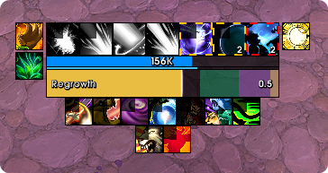
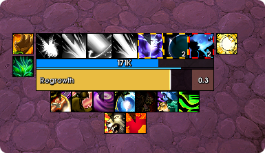

  
  
  

**Cast Queue Overlay** is a cast bar addon for **Retail** that shades the end of your cast bar to show your spell queue window, your latency, or a value of your own, so you can see when your next spell will be accepted instead of guessing.

 

## Features

- Spell queue window shown on your cast bar
- Latency overlay from your home latency
- Custom overlay for any millisecond value
- Colour and opacity for each overlay
- Overlays stacked so none hides another
- Channelled casts marked at the end of the channel
- Separate opacity while channelling
- Works with the default cast bar or any cast bar you pick

## Getting Started

Install it, then `/reload`. The overlays follow Blizzard's cast bar on their own.

Open the options with `/cqo`. Using another cast bar? Press **Select Frame**, hover the bar and click it. Used in combat, `/cqo` opens the window once combat ends.

Install by downloading the latest zip from [Releases](https://github.com/Laxxzz/CastQueueOverlay/releases), or copy the `CastQueueOverlay` folder into `World of Warcraft/_retail_/Interface/AddOns/`.

## The overlays

Each overlay is a coloured band measured backwards from the end of the cast bar, scaled against the cast in progress. Any combination can be on at once.

| Overlay | Value |
|---|---|
| **SpellQueueWindow** | The `SpellQueueWindow` setting, in milliseconds |
| **Latency** | Your home latency, falling back to world latency |
| **Custom** | Any millisecond value you enter |

Each overlay has its own tab with an enable toggle, colour and opacity. The SpellQueueWindow and Latency tabs show the value they currently resolve to. Channelled casts get their own opacity, because a channel starts with the bar full and the overlay needs to stay readable underneath the fill.

## Other cast bars

**Select Frame** starts a picker: hover any frame and its name is shown live, `TAB` cycles through overlapping frames under the cursor, left click selects, `Esc` cancels. Third-party bars are often created after login, so the addon keeps retrying to bind to the frame you named for a short while after you log in. Verified against EllesmereUI's cast bar.

## AI Use

Claude was used in the development of this addon with a custom-built addon development tool constructed from Blizzard's API patch notes.

## Support

Cast Queue Overlay is free. If it saves you guessing when to press your next spell, you can support its development.

## Licence

MIT. See [LICENSE](LICENSE).
